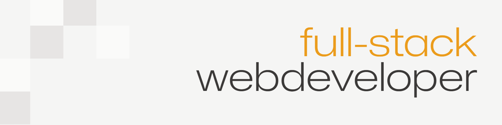

## Hi there, my name is Matilda Smets 🙌

I am an 20-year-old full-stack web developer.

### Skills

## My package(s)

### [Commentable](https://github.com/businesstilto/commentable)

An open-source commenting package for [Filament](https://filamentphp.com/), built to make adding discussions to your Laravel applications easier.

With support for replies, @mentions, reactions, file attachments, and customizable editors, **Commentable** gives you a flexible way to bring conversations directly into your Filament panels.

Built with customisation in mind and actively evolving.

**More packages and projects coming soon!** 👀
